

  

<table border="0">
  <tr>
    <td valign="top" align="center">
      
    </td>
    <td valign="top" align="center">
      
    </td>
  </tr>
</table>

 

<h3><code>sajedul@github ~ $ ls ~/projects</code></h3>

<table border="0">
  <tr>
    <td align="center"></td>
    <td align="center"></td>
    <td align="center"></td>
  </tr>
  <tr>
    <td align="center"><a href="https://sajedulislam5840.github.io/riscv-edge-ai/">Live demo</a> · <a href="https://github.com/sajedulislam5840/riscv-edge-ai">Code</a></td>
    <td align="center"><a href="https://azs-the-catalyst.vercel.app/">Live site</a> · <a href="https://github.com/sajedulislam5840/AZS-The-Catalyst">Code</a></td>
    <td align="center"><a href="https://github.com/sajedulislam5840/CSE422/blob/main/CSE422_Project.ipynb">Notebook</a> · <a href="https://github.com/sajedulislam5840/CSE422">Code</a></td>
  </tr>
</table>

 

<h3><code>sajedul@github ~ $ ls ~/stack</code></h3>

  

<h3><code>sajedul@github ~ $ linguist</code></h3>

  

<h3><code>sajedul@github ~ $ ./contributions.sh</code></h3>

  

<picture>
  <source media="(prefers-color-scheme: dark)" srcset="https://raw.githubusercontent.com/sajedulislam5840/sajedulislam5840/output/github-contribution-grid-snake-dark.svg">
  <source media="(prefers-color-scheme: light)" srcset="https://raw.githubusercontent.com/sajedulislam5840/sajedulislam5840/output/github-contribution-grid-snake.svg">
  
</picture>

---

### About

- **Working on:** [riscv-edge-ai](https://github.com/sajedulislam5840/riscv-edge-ai), a neural network that runs on 8-bit integers only, and a custom RISC-V instruction in Verilog that does four of its multiplications at once. Next step: cycle counts on the Spike simulator with and without the instruction.
- **Also building:** [AZS: The Catalyst](https://github.com/sajedulislam5840/AZS-The-Catalyst), a learning platform used in a pilot by a real coaching batch.
- **Learning:** RISC-V computer architecture, SystemVerilog, and performance-minded C++.
- **Long-term goal:** affordable AI learning tools for students in Bangladesh who do not have powerful GPUs.
- **Reach me:** [Email](mailto:sajedulislam5840@gmail.com) · [Fiverr](https://www.fiverr.com/sellers/sajedulislam584)

<b>Other work</b>

- **SparkEnergies billing and ledger:** a utility billing backend with a normalised (3NF) PostgreSQL schema and a double-entry ledger.
- **Image inpainting research:** a team literature study on deep learning for image completion and generation.

Every card on this page is an SVG generated by the scripts in <a href="./scripts">scripts/</a>. The languages card and the contribution graph are refreshed daily by GitHub Actions.
